# GUI layout and keys

The settled layout, look and proposed keymap of the Dovetail GUI (the Tauri 2 + React client), worked out with the user in a clickable mock on 2026-11-15. The mock is reference, not product code: it shows what to build. Where this file and `docs/design-v2.md` disagree on nouns or behaviour, the design doc wins; this file wins on layout, look and keys.

## The mock

`mock/gui/` is a static mock with fake data (project Shop, repos shop-api and shop-web, five efforts). Run it with:

```
node mock/gui/serve.mjs        # http://127.0.0.1:8765, no dependencies, Node >= 23
```

It serves HTML, CSS and TypeScript (types stripped on the fly) and reloads open pages when a file changes. Everything works by keyboard and by mouse. `?` draws the keyboard for the view in focus. `F2` shows the design-variant panel, which is empty now that every choice is settled; adding a slot to `DESIGN` in `mock/gui/design.ts` starts a new round.

The URL hash sets state for screenshots, for example `#screen="ws"&main="canvas"&effort="pay"`. The screenshots below were taken that way with headless Firefox at 1600 × 950.

## Screens

| | |
| --- | --- |
| 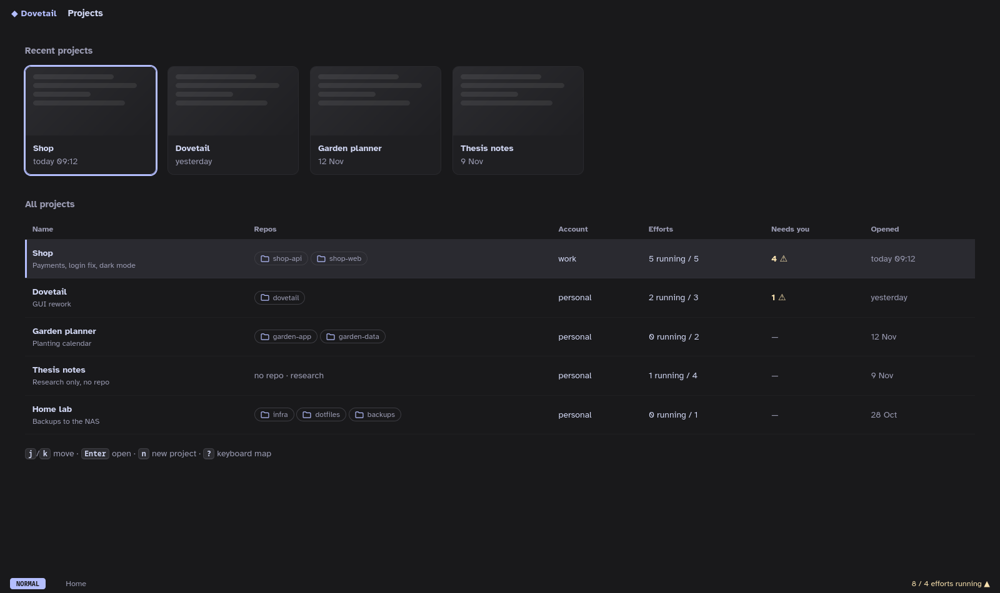 Home: every project, Google-Docs-style list | 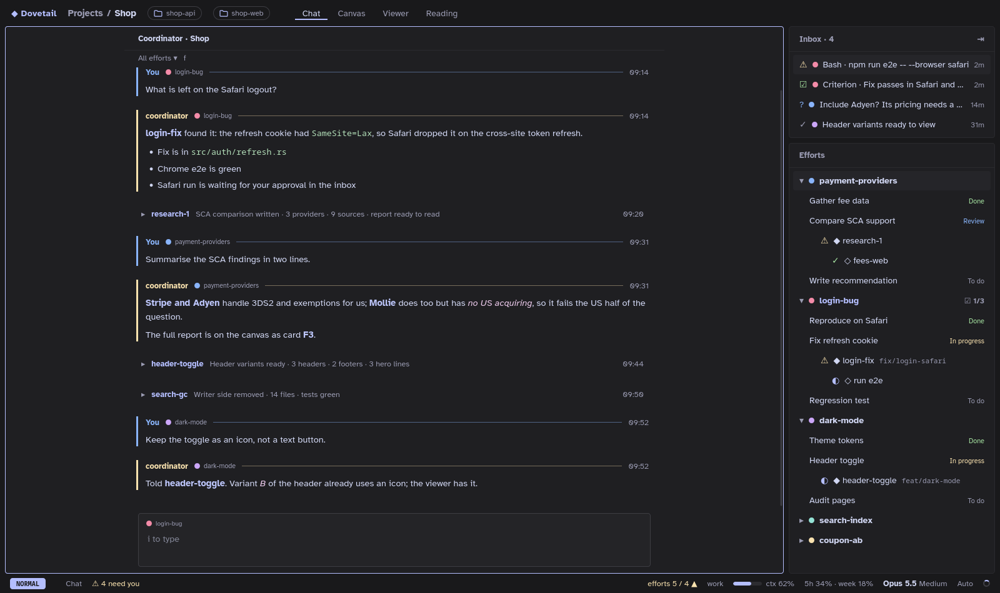 Workspace with no view open: the chat takes the space |
| 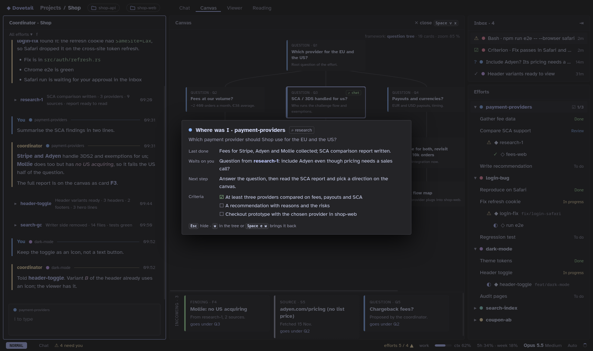 "Where was I" pop-up on switching effort | 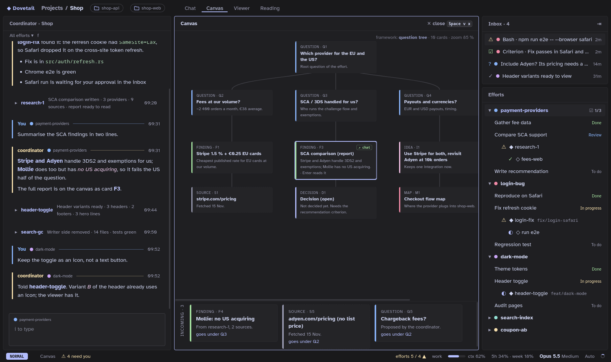 Question-tree canvas with the incoming strip |
| 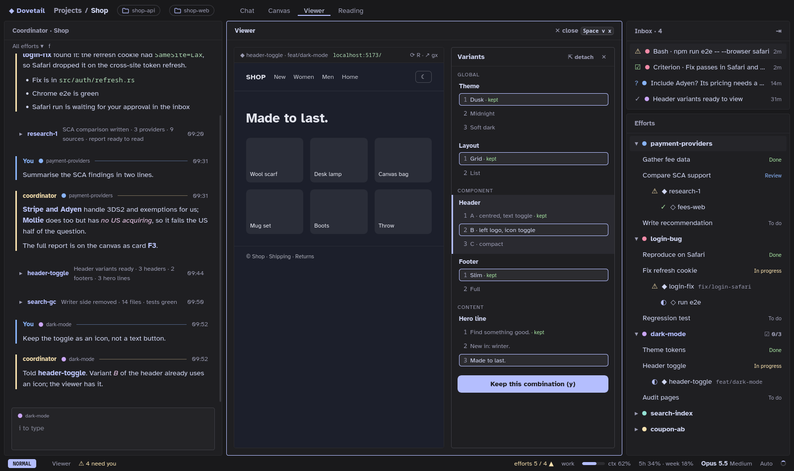 Viewer with the variant panel | 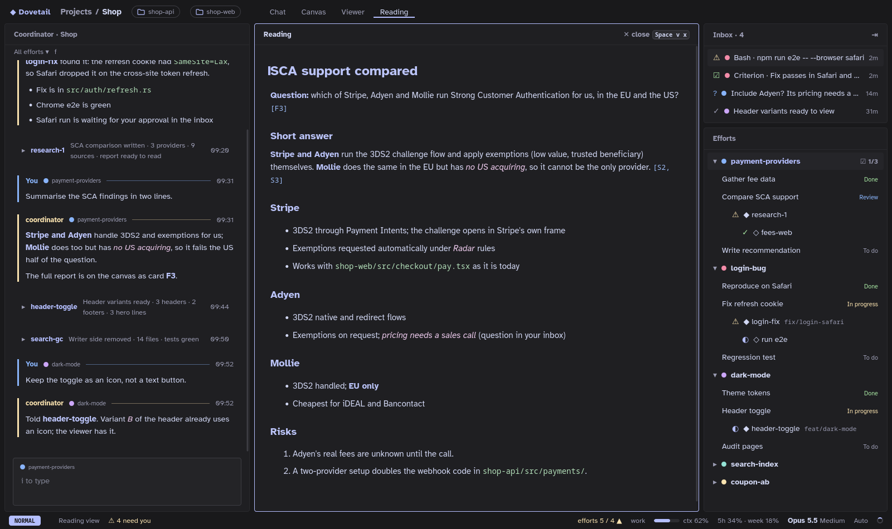 Reading view |
| 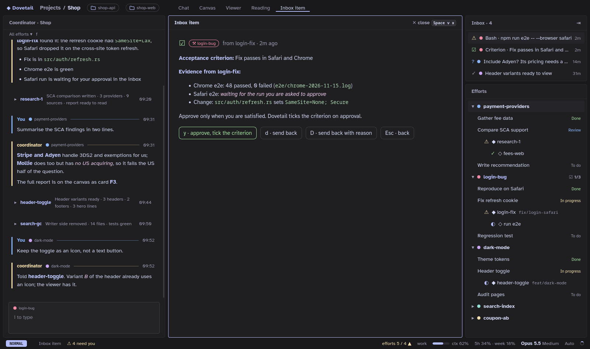 Acceptance-criterion review from the inbox | 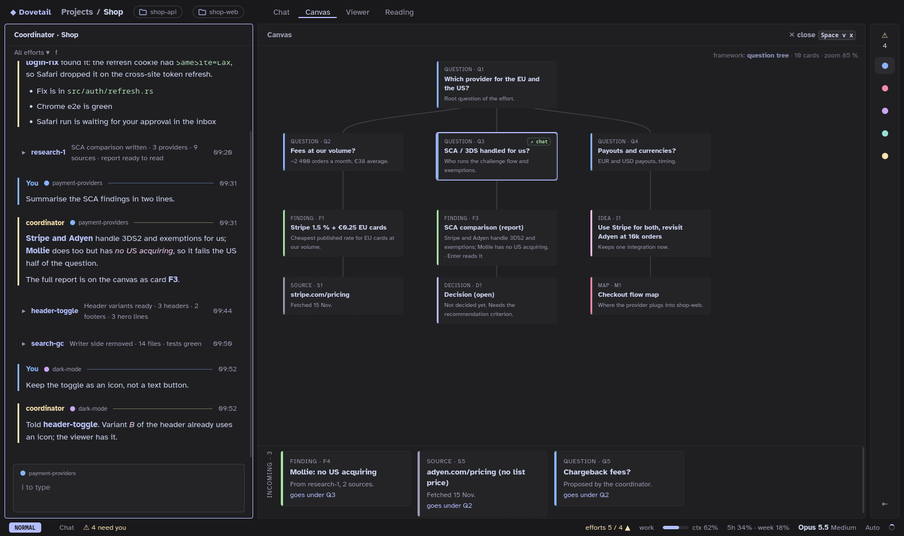 Sidebar folded to a rail |
| 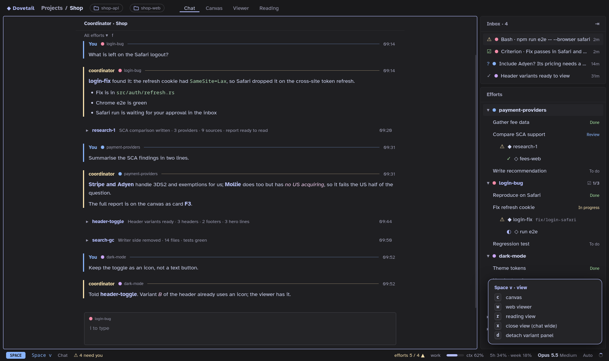 Space leader with the which-key pop-up | 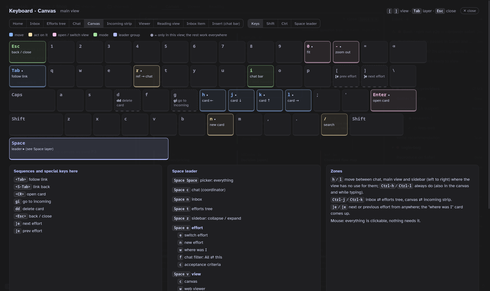 `?` keyboard map, canvas |
| 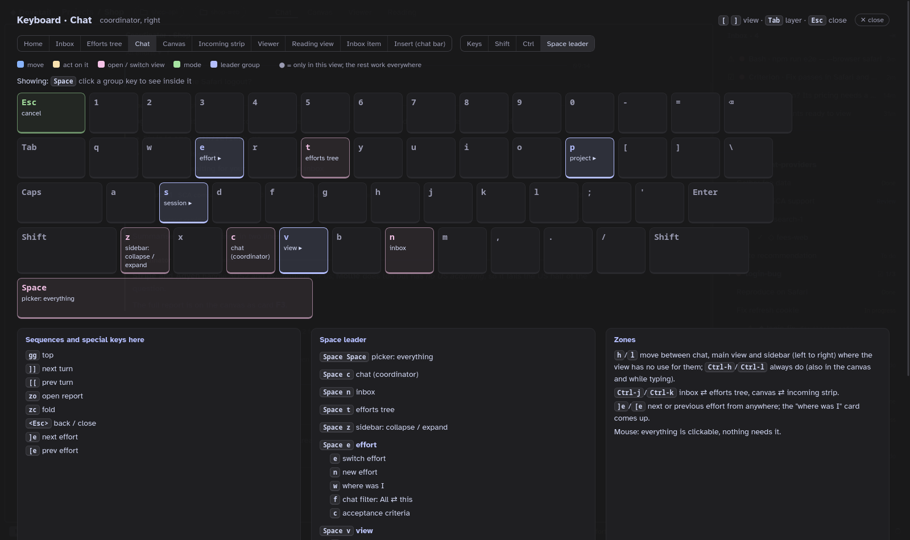 `?` keyboard map, Space leader layer | |

## Layout

- **Home** is the first screen: recent projects as tiles, then all projects as a list (name, repos, account, efforts running, needs-you count, last opened). `Enter` opens a project's workspace.
- **Workspace, left to right:** the coordinator **chat**; the **main view** (canvas, viewer, reading, an inbox item; later map and board); the **sidebar** with the **inbox** above the **efforts tree**. With no main view open the chat takes its space, its reading column centred.
- **Top bar:** brand, `Projects / <project>`, the project's repos (folder icon), and the **view tabs** `Chat · Canvas · Viewer · Reading` (plain words, a line under the open one; `Inbox item` appears while one is open). Nothing else.
- **Bottom bar (all statuses, Claude-desktop style):** left, the mode (`NORMAL`, `INSERT`, `SPACE`), pending keys, the zone in focus, `⚠ N need you` (items that block an agent; finished turns are listed dimmed below them and not counted, ADR 0028); right, `efforts 5 / 4 ▲` (running efforts against `max_efforts` in `config.toml`, default 4; it never blocks), the Claude profile, context fill with a small bar, the usage limits, the model and its effort level (`Opus 5.5 Medium`), the permission mode of the agent `Shift-Tab` would change (`coordinator · Auto`, or the tree's agent), an activity spinner.
- **Sidebar:** the inbox takes only as many rows as it has items and grows downward, up to 40 % of the height; the tree gets the rest. Drag the sidebar's left edge to widen it. `Space z` or the ⇥ button in the inbox title folds it to a rail showing the inbox count and one dot per effort; the rail's ⇤, `Space z` again, or moving to the inbox or tree opens it.
- **Chat width** with a view open: 440 px. Sidebar default 330 px.
- **Chat:** one coordinator chat per project. Each message carries an effort tag, shown as a coloured dot and the effort name in its header. A compact `All efforts ▾` control (`f`) filters to one effort's thread. Slice reports are one collapsed line (`▸ research-1 · …`), `zo` opens one. The input bar shows the effort the next message is tagged with (`Ctrl-t` changes it).
- **Messages:** a header with the speaker, the effort, a rule and the time, all always visible. **You** and the **coordinator** have their own colours (blue and warm yellow), the rule tinted to match, and a 3 px bar of that colour beside each message.
- **"Where was I"** comes up as a pop-up in the middle when switching effort: what the effort is, last done, what waits on you, next step, acceptance criteria. `Esc` hides it; `w` in the tree or `Space e w` brings it back.
- **Canvas:** one per effort, from the start (ADR 0027). It holds **blocks**: framed regions, each with a layout (question tree, options compare, free area) and a title. Agents add blocks in empty space and cards into them; Dovetail places both and nothing moves. `b` then `1 2 3` adds a block. An agent's new card is marked `new` until selected. Cards: finding, source, idea, decision, question, map, each with its own edge colour. Cards an agent put in no block wait in the **incoming strip** under the canvas, which always shows. A card's "↗ chat" button (shown on the selected card) or `r` puts its reference into the chat bar. Long cards open in the reading view.
- **Viewer:** web preview of the slice opened from the tree (`Enter` on it), else the focused effort's slice, with the native **variant panel** beside it in three levels (global, component, content). Mix and match, detach (it floats and can be dragged), close, and "Keep this combination", which tells the slice to make the mix permanent and delete the rest.
- **Agent:** a slice's or subagent's own conversation in the main view (tab named after the agent while one is open). Messages in the chat's style, its tool activity as one dim line per turn, what it waits on you for (permission requests, questions) in boxes above its own chat bar, answered with the inbox keys. `i` types to it, tagged with its task's effort. Opened from an inbox item (`Enter`), the tree (`Enter` on a subagent, `c` on any agent or task), a slice's report line in the chat (`Enter`), a canvas card (`ga`: the agent that added it) and `Space s s`. Added 2026-11-17 (`docs/plan/usable-v2.md`); not in the mock.
- **Inbox item:** `Enter` on an inbox row opens it in the main view in full. A permission request answers with `y A d D`; an acceptance-criterion review with `y` (approve, Dovetail ticks the criterion) or `d`/`D` (send back, with a reason).

## Look

All values are CSS variables in `mock/gui/style.css` (`:root`) and port unchanged to the real app.

| What | Value |
| --- | --- |
| Theme | Mist (the TUI's palette, colour research palette B) on neutral dark greys |
| Surfaces | page `#19191b`, panels `#1f1f22`, raised `#2c2c30`, frames `#2a2a2e`, focus frame = accent |
| Text | body `#d0d6f2`, chrome `#9a9bb2` |
| Roles | bold `#b4befe`, italic `#f5c2e7`, code `#a6e3a1`, links `#89b4fa`, accent `#b4befe`, error `#f38ba8`, warning `#f9e2af` |
| Highlight colours in text | softened: 70 % role colour, 30 % body text colour (`color-mix`) |
| Speakers | you = link blue, coordinator = tag yellow |
| Regions | framed panels (1 px frame) on the page background, 8 px apart, little inside them: no uppercase titles, chips or key hints |
| Corners | 4 px (3 px for rows and small items) |
| Font | Atkinson Hyperlegible (the real app bundles it; the mock loads it from Google Fonts) |
| Text size | 14 px base |
| Line spacing | 1.5 |

Rejected along the way: the deep purple Iris theme, Iceberg (too blue), a fully borderless "calm" look (too bare), 12 px corners (too round), 16–18 px text (too big), the boxed tab bar.

## Naming

- Effort names are **lower kebab case** (`payment-providers`, `login-bug`). Typed names are converted automatically: "Dark mode" is saved as `dark-mode`.
- A slice is not named after its effort (the mock's `dark-mode` effort has the slice `header-toggle`).

## Keys

**Status: proposed, not yet reviewed by the user.** The iteration covered layout and look; the keymap below is the mock's first proposal and still needs its own review round (the `?` overlay is the way to do it). It keeps the TUI's muscle memory where the nouns survive: `i`, `Esc`, `:`, Space leader, `]]`/`[[`, `zo`/`zc`, the inbox answers `y A d D r x`, `Space c`, `Space n`, `Space s s/x/m`.

Modal: **Normal** (navigate and act), **Insert** (typing in the chat bar), Space as leader with mnemonic groups (`e` effort, `v` view, `p` project, `s` session). `h`/`l` move between chat, main view and sidebar where the view has no use for them; `Ctrl-h`/`Ctrl-l` always do, including in the canvas and while typing. `Ctrl-j`/`Ctrl-k` move between inbox and tree, and between canvas and incoming strip. The mouse is optional everywhere.

**Everywhere (Normal mode)**

| Keys | Does |
| --- | --- |
| `h` | zone ← |
| `l` | zone → |
| `Ctrl-h` | zone ← (always) |
| `Ctrl-l` | zone → (always) |
| `Ctrl-j` | zone ↓ |
| `Ctrl-k` | zone ↑ |
| `i` | chat bar |
| `:` | command |
| `?` | keyboard map |
| `Esc` | back / close |
| `]e` | next effort |
| `[e` | prev effort |
| `/` | search |

**Home**

| Keys | Does |
| --- | --- |
| `j` | next project |
| `k` | prev project |
| `gg` | first |
| `G` | last |
| `Enter` | open project |
| `n` | new project (selected once made) |
| `r` | add repo |
| `x` | remove repo (picker, then confirm) |

**Inbox**

| Keys | Does |
| --- | --- |
| `j` | next item |
| `k` | prev item |
| `Enter` | open in full |
| `y` | allow / approve |
| `A` | always allow |
| `d` | deny / send back |
| `D` | deny with reason |
| `r` | reply |
| `x` | dismiss |
| `e` | item's effort |

**Efforts tree**

| Keys | Does |
| --- | --- |
| `j` | next row |
| `k` | prev row |
| `o` | fold / unfold |
| `Enter` | open (a slice: its preview in the viewer; a subagent: its conversation) |
| `c` | the agent's conversation (a task: its slice's) |
| `w` | where was I |
| `a` | add task |
| `e` | rename |
| `J` | move down (a task, among its effort's) |
| `K` | move up |
| `dd` | archive, after a keep/archive picker (a task: archived, its slices end; an effort: closed; a slice: ended) |
| `Shift-Tab` | the agent's permission mode (a subagent: its slice's) |

**Chat**

| Keys | Does |
| --- | --- |
| `j` | scroll ↓ |
| `k` | scroll ↑ |
| `gg` | top |
| `G` | bottom |
| `]]` | next turn |
| `[[` | prev turn |
| `zo` | open report |
| `zc` | fold |
| `f` | filter: All ⇄ effort |
| `Enter` | a report line: that agent's conversation |
| `Shift-Tab` | coordinator's permission mode |
| `Ctrl-j` | chat bar |

**Canvas**

| Keys | Does |
| --- | --- |
| `h` | card ← |
| `j` | card ↓ |
| `k` | card ↑ |
| `l` | card → |
| `Tab` | follow link |
| `Shift-Tab` | link back |
| `Enter` | open card |
| `r` | ref → chat |
| `n` | new card |
| `H` | move card ← |
| `J` | move card ↓ |
| `K` | move card ↑ |
| `L` | move card → |
| `gi` | go to incoming |
| `dd` | delete card |
| `+` | zoom in |
| `-` | zoom out |
| `0` | fit |
| `ga` | the agent that added the card |
| `b` `1` | new block: question tree (`b` pops up the layouts) |
| `b` `2` | new block: options compare |
| `b` `3` | new block: free area |

**Incoming strip**

| Keys | Does |
| --- | --- |
| `h` | prev card |
| `l` | next card |
| `a` | place on canvas (under the card linking to it, else in the newest block) |
| `x` | drop |
| `r` | ref → chat |
| `k` | back to canvas |
| `Esc` | back to canvas |

**Viewer**

| Keys | Does |
| --- | --- |
| `j` | next slot |
| `k` | prev slot |
| `Tab` | next variant |
| `Shift-Tab` | prev variant |
| `1` | variant 1 |
| `2` | variant 2 |
| `3` | variant 3 |
| `y` | keep this combination |
| `u` | back to kept |
| `p` | variant panel |
| `D` | detach / dock panel |
| `q` | close panel |
| `R` | reload |
| `gx` | open in browser |

**Reading view**

| Keys | Does |
| --- | --- |
| `j` | scroll ↓ |
| `k` | scroll ↑ |
| `gg` | top |
| `G` | bottom |
| `]]` | next heading |
| `[[` | prev heading |
| `r` | ref → chat |
| `gx` | open source |

**Inbox item**

| Keys | Does |
| --- | --- |
| `y` | allow / approve |
| `A` | always allow |
| `d` | deny / send back |
| `D` | deny with reason |
| `r` | reply |
| `x` | dismiss |
| `Enter` | open the agent |

**Agent** (a slice's or subagent's conversation)

| Keys | Does |
| --- | --- |
| `j` | scroll ↓ |
| `k` | scroll ↑ |
| `gg` | top (pages in older messages) |
| `G` | bottom |
| `]]` | next turn |
| `[[` | prev turn |
| `y` | allow its oldest request |
| `A` | always allow |
| `d` | deny |
| `D` | deny with reason |
| `r` | reply to its question |
| `x` | dismiss |
| `Shift-Tab` | its permission mode (a subagent: its slice's) |
| `Ctrl-j` | its chat bar |
| `Esc` | back |

**Insert (chat bar)**

| Keys | Does |
| --- | --- |
| `Enter` | send |
| `Alt-Enter` | new line |
| `Ctrl-t` | change effort tag |
| `Shift-Tab` | permission mode (coordinator; in an agent view, that agent) |
| `Ctrl-k` | leave bar (keep draft) |
| `Esc` | Normal mode |
| `Ctrl-w` | delete word |
| `Ctrl-u` | delete line |
| `Ctrl-v` | paste / image |

**Space leader**

| Keys | Does |
| --- | --- |
| `Space Space` | picker: everything |
| `Space c` | chat (coordinator) |
| `Space n` | inbox |
| `Space t` | efforts tree |
| `Space z` | sidebar: collapse / expand |
| `Space e e` | effort: switch effort |
| `Space e n` | effort: new effort |
| `Space e w` | effort: where was I |
| `Space e f` | effort: chat filter: All ⇄ this |
| `Space e c` | effort: acceptance criteria |
| `Space v c` | view: canvas |
| `Space v w` | view: web viewer |
| `Space v r` | view: reading view |
| `Space v x` | view: close view (chat wide) |
| `Space v d` | view: detach variant panel |
| `Space p p` | project: switch project |
| `Space p h` | project: home (all projects) |
| `Space p r` | project: add repo |
| `Space s s` | session: pick agent |
| `Space s x` | session: interrupt (the agent view's or tree cursor's agent, else the coordinator) |
| `Space s m` | session: permission mode (in the tree: its agent) |

Not mocked yet: rename, search, the board and maps (not in the first release). The agent view, reorder and archive were built without a mock (2026-11-17, `docs/plan/usable-v2.md`); their keys (`c`, `ga`, `Enter` in the chat, the Agent scope) are proposals like the rest.
